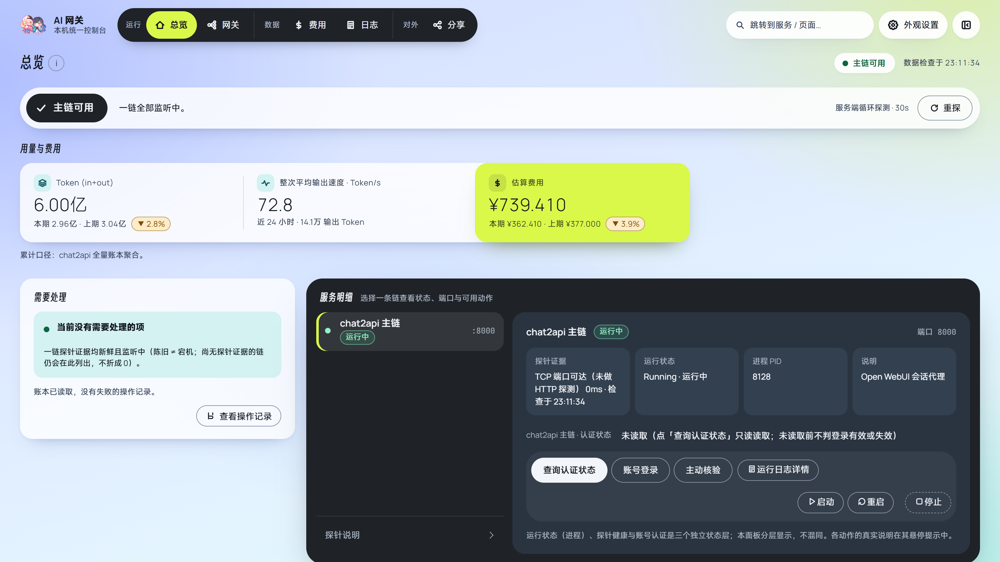
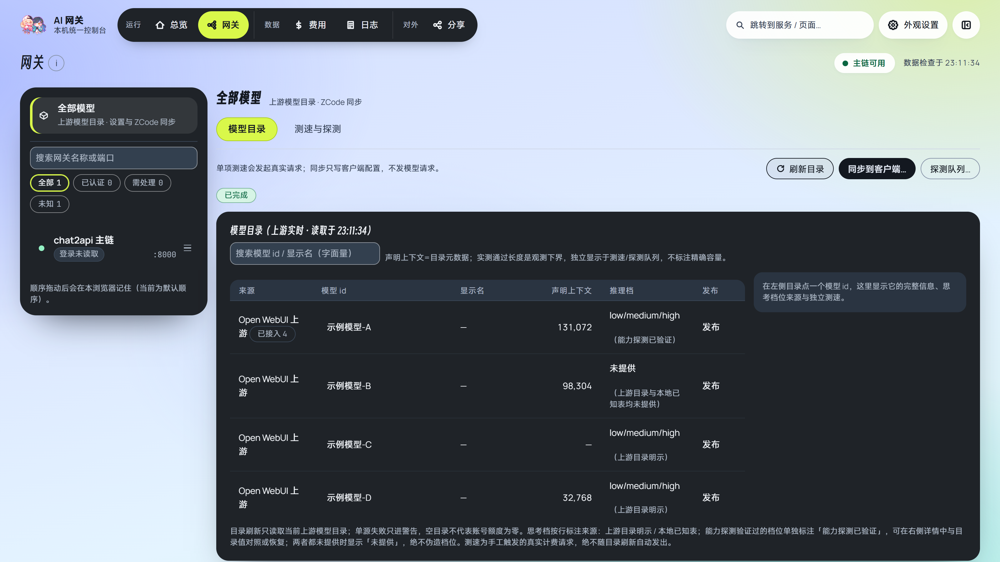
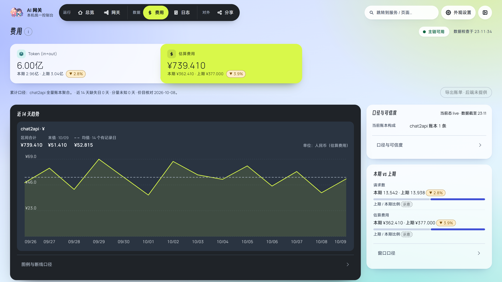

# Chat2API 网关控制台

把 Open WebUI 中的模型接入本地客户端，并通过中文控制台管理登录、模型、运行日志、Token 用量和费用。

本项目以个人使用为主。在 chat2api 的基础上，补充了认证失效后的重登录、上游临时故障重试、请求诊断日志和可选进程守护，方便排查长时间任务中的掉线问题。中文控制台统一管理账号、模型、日志、用量和分享，当前支持 **ZCode 模型同步和 Tailscale 分享入口**。

**分享功能请在遵守相关规定下使用。** 

代码与文档包含 AI 辅助开发的内容，模型页面的UI还不够完善，欢迎审查并提交PR。

下面内容是由ai总结的，有问题请提issue。

## 功能一览

| 功能 | 可以做什么 |
| --- | --- |
| 本地模型 API | 将 Open WebUI 模型提供给支持 OpenAI Chat Completions 或 Anthropic Messages 的客户端 |
| 账号管理 | 查询认证状态、打开登录页面、主动核验上游凭据 |
| 自动重连 | 在允许的阶段重试临时网络／上游错误，认证失效时协调重登录 |
| 进程守护 | 另行启用后，有界恢复异常退出的本地网关，尊重主动停止意图 |
| 模型管理 | 刷新目录，查看上下文、输出上限与思考档位，保存配置草稿 |
| ZCode 同步 | 选择范围、预览差异、应用受管配置，并显示读回或延期原因 |
| 运行日志 | 按来源、时间、分类和关键词查事件，查看请求诊断与原始记录 |
| 用量与费用 | 查看输入／输出 Token、整次平均输出速度和参考费用，区分未知与零 |
| 可选分享 | 独立的入口与专用后端、分享 Key 管理、每 Key 费用和分层维护 |

公开源码只保留 chat2api 网关和 ZCode 同步，不附带账号、API Key、浏览器资料、账本或运行状态。上游目录可以包含不同厂商的模型，均通过 chat2api 接入。

## 网页界面

控制台在本机运行（默认 `http://127.0.0.1:8096/`）。下面的截图来自公开版本的构建产物，由本机回环随机端口的静态服务和独立浏览器生成，界面是当前真实实现，数据为**演示数据**：示例模型、示例 Token 与参考费用，**不含账号、API Key、真实账本或分享链接**。

### 总览



首屏是运行裁决（各链是否监听中）与用量读数，下面依次是需要处理队列和服务明细；趋势图在第二层，不参与上方的可用性裁决。

### 网关的模型页



在「网关 → 全部模型」里刷新目录（只读），查看模型 id、声明上下文、推理档位来源与发布状态；同步只写客户端配置，不发起模型请求。

### 费用页



近 14 天趋势、口径与可信度、本期与上期对比，以及各网关费用、模型调用明细和价目表。参考费用来自本机价目文件，不是上游真实账单。

## 1. 一键部署与首次使用

### 环境要求

- Windows，已安装 Python 3.11+、Node.js 22.12+（含 npm）和 Microsoft Edge。
- 一个你有权访问的 Open WebUI 地址和账号。
- 模型同步需要安装 ZCode；分享功能另需 Tailscale 和相应部署权限。

### 部署流程

1. 将源码放到固定目录，双击 **[一键部署启动.bat](一键部署启动.bat)**。
2. 首次输入 Open WebUI 基础地址，例如 `https://your-openwebui.example`。直接回车使用 `http://localhost:3000`。
3. 启动器创建本目录的 `.venv`，安装 Python 和 npm 项目依赖，构建页面，启动网关与控制台。
4. 在控制台“网关”页选择 chat2api，进入“账号”，完成登录并查询认证状态。
5. 在客户端配置本地 API 地址，并选择目录中的真实模型 ID。

| 用途 | 默认地址／端口 |
| --- | --- |
| 中文管理控制台 | `http://127.0.0.1:8096/` |
| OpenAI 客户端 Base URL | `http://127.0.0.1:8000/v1` |
| Anthropic 客户端 API 根地址 | `http://127.0.0.1:8000`，请求路径为 `/v1/messages` |
| 可选分享入口 | 8100 |
| 分享专用后端 | 8110 |

再次运行会复用环境和未变化的页面，保留健康的实例。外来进程占用端口、残留进程或健康异常时会拒绝启动，需要先明确处理原实例。部署过程中不要移动目录。

**一键部署不自动安装系统级 Python／Node，不注册守护任务、创建 Windows 账户或开启公网分享。** 自动重登录的完成程度取决于登录页面兼容性；验证码、二次确认或不支持的页面需要用户在浏览器完成。

### 修改上游地址

地址保存在 `data/launcher-settings.json`。选择顺序为：`-UpstreamUrl` 参数 → `AI_GATEWAY_OPENWEBUI_URL` 环境变量 → 已保存地址 → 首次输入。

```powershell
# 只准备依赖、构建和配置，不启动服务
powershell -NoProfile -ExecutionPolicy Bypass -File .\setup-and-start.ps1 -SetupOnly -UpstreamUrl https://your-openwebui.example

# 只读检查环境和端口，不安装、不写配置、不启停服务
powershell -NoProfile -ExecutionPolicy Bypass -File .\setup-and-start.ps1 -CheckOnly
```

保存新地址不会修改正在运行的实例；主动停止后再启动才会采用新地址。服务入口使用本目录的独立数据文件，不沿用其他副本的凭据、账本或状态文件路径。

## 2. 日常操作与客户端连接

部署后双击 `Open-GatewayConsole.bat` 打开控制台。关闭网页不会停止网关；停服务应使用页面上的“停止”。

在“网关 → chat2api → 账号”中：

- **查询认证状态**：读取认证事实；“未读取”“未知”不代表账号掉线。
- **账号登录**：打开独立浏览器资料进行登录，等待完成后再查询状态。
- **主动核验**：向上游验证凭据，不发模型推理请求。
- **启动／重启／停止**：管理服务进程。重启会影响正在执行的请求，认证失效优先处理登录。
- **运行日志详情**：跳到该网关的日志记录。

进程是否运行、上游是否可达、账号是否已认证是三种不同状态，不能仅凭端口可达判断登录成功。

### API Key

`CHAT2API_LOCAL_API_KEY` 可以为本地接口设置调用密钥。它是下游调用密钥，与 Open WebUI 登录 token 分开。

```powershell
# 在同一个窗口设置后启动，不要把真实密钥写进源码
$env:CHAT2API_LOCAL_API_KEY = 'replace-with-your-own-local-key'
.\一键部署启动.bat
```

客户端使用相同 Key；OpenAI 接口使用 `Authorization: Bearer ...`，Messages 接口也支持 `x-api-key`。控制台与网关应从同一环境启动；变更密钥需重新载入对应实例。

未设置该变量时，默认回环地址的模型接口不要求本地调用密钥；客户端若要求非空 Key，可以填写占位值，不应填上游登录 token。此时上游账号仍需要登录。默认只监听本机；管理控制台保留 Host／Origin 和管理凭据校验，不应作为公网管理入口。

## 3. chat2api 自动重连如何工作

“自动重连”分为请求重试、认证恢复和进程恢复，分别处理不同故障。

### 临时网络与上游错误

连接失败、超时或可重试的 `408 / 429 / 500 / 502 / 503 / 504`，会在请求阶段和剩余预算允许时重试。默认快速失败最多重试 5 次；单次尝试已耗时至少 30 秒时，使用最多 2 次的慢失败预算。整个请求还受总耗时和物理尝试次数上限约束。

流式请求已向客户端输出可见内容后，不会拼接第二次独立生成来假装续传。中断会留下错误与结束诊断，客户端可能仍需重新发起任务。参数不合法的 `400 / 422` 也不能靠网络重试修好。

### 认证失效与重登录

1. 启动后在后台核验保存的凭据，管理页面可以先打开。
2. 业务请求收到上游 `401` 时，立即进入认证恢复判断，**不必等下一轮定时检查**。
3. 允许恢复时协调一个重登录会话，多个请求不会各自同时打开登录窗口。
4. 登录成功且请求仍有预算时，最多进行一次认证后的重发；失败则明确返回认证错误。
5. 空闲时也做非推理的凭据检查，正常间隔约 5 分钟，未确认有效时退避，最长约 30 分钟。

超时或上游 5xx 只表示“无法确认”，不能直接当成凭据过期。自动登录失败后不会持续弹窗；处理页面问题后，可在控制台明确重新发起登录。重登录会话还有跨实例协调与次数限制，避免反复提交。

普通登录、单点登录、验证码和二次确认的行为可能不同，需要人操作的页面仍应由用户完成。显式使用 `--no-browser --token ...` 时不执行浏览器重登录。

### 进程异常退出后的守护

守护需要**另行注册**，不是一键部署的默认动作。在本目录的 PowerShell 中可执行：

```powershell
# 注册本版本的守护任务并启用生命周期控制
powershell -NoProfile -ExecutionPolicy Bypass -File .\lib\register-chat2api-watch.ps1 -Action Register

# 不再使用时撤销任务
powershell -NoProfile -ExecutionPolicy Bypass -File .\lib\register-chat2api-watch.ps1 -Action Unregister
```

注册后，通过控制台或 `invoke-gateway-service.ps1` 启动 chat2api，记录本次开机的运行意图和健康确认。一键部署的直接启动不会自动建立这套守护意图。

守护默认每分钟观察一次。只有本次开机有明确运行意图、启动已确认成功、连续两次就绪检查失败、进程确已消失且端口没有外来占用等条件同时满足，才恢复实例。默认每小时最多启动 3 次。

主动停止不会被拉起；重启电脑也不会沿用上一次开机的运行意图。进程仍在但认证失效或上游超时，不触发进程重启。移动目录后，已注册任务的脚本路径需要重新核对。

### 常用重试设置

变量应在启动进程前设置，修改不会即时改变已有实例。

| 环境变量 | 默认值 | 用途 |
| --- | --- | --- |
| `CHAT2API_UPSTREAM_AUTO_RETRY` | `1` | 临时上游故障自动重试，设为 `0` 关闭 |
| `CHAT2API_UPSTREAM_AUTO_RETRIES` | `5` | 快速失败的重试预算 |
| `CHAT2API_UPSTREAM_SLOW_RETRY_THRESHOLD_S` | `30` | 慢失败的单次耗时阈值，秒 |
| `CHAT2API_UPSTREAM_SLOW_AUTO_RETRIES` | `2` | 慢失败的重试预算 |
| `CHAT2API_MAX_TOTAL_ATTEMPTS` | `12` | 物理上游尝试次数上限，含认证后重发 |
| `CHAT2API_MAX_REQUEST_SECONDS` | `360` | 聊天请求整体耗时预算，秒 |

重试可能增加上游用量；客户端重试与网关重试也会叠加。排查时应看物理尝试记录，而不只看发送消息的次数。

## 4. 详细日志与排查工作流程

### 从控制台查日志

1. 打开“日志”，在“全部运行日志”看本次读取窗口的事件总览，或选择 chat2api 来源。
2. 按“错误／异常”“警告”“信息”“通过”等分类筛选，再结合时间与关键词缩小范围。
3. 查看摘要，必要时展开原始内容并复制。带请求标识的记录可使用“查看该请求相关记录”。
4. 范围不够时加载更早记录；日志轮转后选择对应历史文件。

错误、警告、成功、信息与未分类使用不同颜色。`INFO` 只是信息级日志，只有明确的成功结果才归入“通过”。总览统计来自各来源本次读取窗口，并非全历史累计；按请求筛选也受当前文件和读取范围约束。

### 各文件的用途

| 文件／位置 | 记录什么 | 什么时候看 |
| --- | --- | --- |
| `chat2api/chat2api.log` | 启动、认证、重试、流结束、上游拒绝和请求摘要 | 大多数运行问题的首选 |
| `chat2api/chat2api.console.log` | 隐藏启动器的输出、错误和退出码 | 服务没起来或主日志尚未生成 |
| `usagesrv.console.log` | 隐藏启动的控制台后端输出和错误 | 8096 启动失败、页面无法打开 |
| `data/usage-chat2api.jsonl` | Token／用量事实与请求状态，供费用页聚合 | 用量与费用核对，不是重复运行日志 |
| `%LOCALAPPDATA%/AIGatewayPublic/watch/chat2api-watch.log` | 已启用守护的判定和恢复结果 | 异常退出后没恢复或达到恢复上限 |

主日志使用 UTF-8，单文件约 10 MiB 轮转，保留 5 份历史文件；隐藏启动器日志保留当前和上一轮文件。控制台日志读面会脱敏并限制读取窗口。提交问题时仍应检查截图与复制内容是否带有凭据。

### 关键事件怎么读

| 事件／字段 | 含义 |
| --- | --- |
| `startup` | 构建标识、实例角色、端口、PID、启动来源和重试配置 |
| `reauthentication session started / failed / refused` | 重登录开始、失败或被协调／次数门禁拒绝 |
| `credential check inconclusive` | 凭据检查无法确认，不能据此认定掉线 |
| `upstream auto-retry` | 临时故障原因、重试延迟和预算使用情况 |
| `upstream_reject` | 上游 400／422，带模型、错误摘要、请求结构和输出预算诊断 |
| `stream end` | 流结束状态、耗时和可获得的上游追踪信息，不一定带本地请求 ID |
| `request summary` | 本地请求 ID、最终状态、物理尝试数、重试次数和耗时等 |
| `output_budget` | 实际转发的输出 Token 参数，不代表上游已经批准该额度 |

**推荐顺序：故障时间 → 最终请求摘要 → 带相同 `request=` 的诊断 → 认证／重试状态 → 启动器或守护日志。** 客户端 TraceID、上游 ID 不一定等于网关请求 ID；缺少同一标识的行不能仅凭模型名称当成同一个请求。

### 常见故障

| 现象 | 先查什么 | 处理方向 |
| --- | --- | --- |
| 400／422，压缩会话后恢复 | `upstream_reject` 的错误和输入／输出预算 | 可能是上下文、输出申请、图片或参数限制，以证据判断 |
| 401 或需要登录 | 认证状态、重登录开始／失败／拒绝记录 | 完成登录，检查浏览器页面和次数门禁 |
| 502／503／超时 | 重试原因、慢重试次数、最终耗时 | 区分上游、认证与进程问题，避免反复重启全部服务 |
| 流中断 | `stream end` 和 `request summary` | 已输出后的中断不能自动拼接新回复，检查是否需要重发 |
| 控制台打不开 | 8096 进程、端口归属、`usagesrv.console.log` | 先查启动失败与占用，再打开控制台 |
| 进程退出后没恢复 | 守护任务、运行意图、守护日志 | 确认已注册、本次启动已记录，且不是主动停止或达到上限 |

报告问题时提供版本／启动标识、故障时间、协议、模型 ID、错误码和脱敏后的相关日志即可。不要附登录 token、API Key、浏览器资料或完整用户账本。

## 5. 模型目录、配置与 ZCode 同步

“网关”页的“全部模型”展示完整范围；选中 chat2api 后，可在其“模型”页查看目录。目录从 `/v1/models` 读取。

1. 刷新目录，查看模型 ID、声明上下文、输出上限和思考档位来源。
2. 调整别名、上下文或有依据的默认思考档位时，先保存草稿；保存不直接修改 ZCode。
3. 明确选择全部／选中范围；只同步选中时，空选不执行。
4. 预览配置差异，再应用，检查读回、待同步或延期状态。

先在 ZCode 配置指向本地 API 的供应商。同步只合并受管范围，不整体替换其他供应商；受管字段会受同步影响，应用前应核对预览中的已有值与新值。

运行中同步需要满足客户端版本／内容准入、文件锁、冲突检查和写后读回条件，否则延期，不自动退出或重启 ZCode。“已写入”“客户端已加载”“会话已采用”是不同状态，不能把写文件成功当成会话切换成功。

上游声明与实测上下文分开：实测通过的长度是带单位的**已验证下界**，不是精确最大容量；可以明确选用有证据的值作为配置。输出上限只读。目录刷新和普通同步不发推理；测速、能力和长上下文探测是独立的计费操作。

## 6. Token 用量和参考费用

“费用”页读取本地账本，展示输入、输出、缓存和推理 Token（视上游提供情况）、趋势及模型明细。整次平均输出速度按可信输出 Token 与整次请求耗时计算，包含首字等待，不是逐 Token 的瞬时速度。

初始不附带私人价目表。需要统计费用时，将 `examples/prices.json` 复制到 `data/prices.json`，按示例结构填写自己的模型参考价格和核对日期，再刷新费用读面。

参考费用不是上游真实账单。真实零、未知用量、未定价和估算分别展示；未归属的分享账本记录不猜分到某个 Key。分享读面提供 Key 名称、每日／模型用量与费用，轮换合并依赖已记录的身份关系。

## 7. 可选分享链

分享链为 **8100 入口 → 8110 专用后端 → Open WebUI**，与个人 8000 的凭据、浏览器资料和账本隔离。8100 管理分享 Key 与入口访问，8110 负责独立的上游会话。

完成独立身份、受控目录、凭据和 Tailscale 部署后，在分享页开启／停止整链，查看准备条件；可使用“仅重新认证 8110”“仅重启 8110”“仅重启 8100”等单层维护。维护仍会影响该层正在处理的请求；个人 8000 正常不代表分享后端已登录。

开启确认与恢复边界：受限的启动动作只运行任务一次，随后按总时限确认就绪（任务、分享进程、端口三证；读取失败不算成功），就绪预算严格小于协议交换时限与控制台该层预算，调用超时后不会再有晚到的成功留下无主实例。轮询期间并发的停止一旦确认关闭，本次开启绝不报成功（停止优先）。**该层已在运行时开启也要做一次受管确认**：只有成功的受管开启动作才会把受保护的生命周期记录从先前的紧急停止刷成运行，监督判据才随之一致；只凭端口在场或读面观察不会把停止改成运行。未经本次有效开启动作，人工停止与紧急停止仍然禁止自动恢复。

费用读取边界：控制台费用接口的 Key 名称投影只经 `share_store.read_key_labels` 的只读连接（`mode=ro`、只读查询）读取，绝不装配分享管理器、绝不读部署配置、绝不开 broker 管道；名称读不到时如实为未知（不折成空名、不折成零），费用与名称都不丢。带撤销意图的已删除 Key 仍返回名称与费用，读取不恢复也不停止分享。

分享支持 OpenAI Chat Completions 与 Anthropic Messages 的流式／非流式，以及文本、工具、thinking 和受控图片。Files、Batches 和没有可信原生计数依据的 `count_tokens` 入口不提供。对外只发布分享入口，控制台继续留在本机。

一键部署不执行特权分享安装或自动注册分享监督任务。冷启动、外部访问和真实请求需要在自己的部署环境验收。

## 8. 手动启动与开发

不使用一键启动器时：

```powershell
python -m pip install -r requirements.txt
cd web
npm ci --ignore-scripts
npm run check
npm run build
cd ../..
```

先登录保存凭据，再分别启动网关与后端：

```powershell
python chat2api/chat2api.py --base-url https://your-openwebui.example --login
python chat2api/chat2api.py --base-url https://your-openwebui.example
# 另一个窗口执行
python usagesrv.py
```

部署后的 `start_chat2api.bat` 和 `start_usage_service.bat` 优先使用本目录 `.venv`。前端开发与代理设置见 [前端 README](web/README.md)，术语见 [CONTEXT.md](CONTEXT.md)。

### 验证与公开提交

```powershell
python -m unittest discover -s tests
powershell -NoProfile -ExecutionPolicy Bypass -File tests/public-launcher.Tests.ps1
cd web
npm run check
npm run check:logs
npm run check:scope
npm run build
```

`npm run check:logs` 是控制台日志页的离线判据：分类、真实 0 与未知、跨日日期与小时刻度、刷新间复制精确性、筛选切换、重复事件、剪贴板拒绝、原文折叠、两主题与窄屏分类色条、详情筛选计数。它不连接任何真实服务。

隔离测试与构建不代表真实登录、客户端当前会话或公网分享已验收。提交前运行 `python tools/audit_public_tree.py`；确认上传目录干净后，用 `--write-manifest` 更新源码哈希。该工具检查已定义规则，不能保证发现所有秘密。

## 9. 数据与许可证

凭据、Key、浏览器 profile、日志、账本、数据库、`.venv`、`node_modules` 和构建目录属于本机数据或生成物，不应上传。不要把其他项目或私人历史的 `.git` 目录带入公开仓库。

chat2api 基于 Sozbo-Tang/openwebui-chat2api 的修改版。所包含的第三方代码与字体许可见 [THIRD_PARTY_NOTICES.md](THIRD_PARTY_NOTICES.md)。

### 分享关闭的时间预算

优雅关闭先用最多60秒通知实例并等待在途请求，再留20秒停止阶段；管理调用最多90秒。紧急关闭直接使用20秒停止阶段，管理调用最多30秒。实例通知最多使用停止阶段的一半，给宿主停止及关闭核验保留时间；通知失败不跳过宿主停止。

实例管道连接、身份核验、单次重试与收发沿用同一截止点。到期后不再发送请求或重新起算超时；阻塞原生调用沿用有界放弃与工作线程额度，可能多出既有的短收尾观察窗口。任务、进程或端口核验失败时结果为未确认，不能把已发停止命令当作已关闭。上述预算修复在载入运行实例后生效。

### ZCode 运行中同步的兼容性

运行中同步按文件锁、配置格式及变更监听的已验证协议判断，版本号仅展示，整包或整份bundle摘要不限制升级。无关代码变化和依赖chunk改名可兼容；关键协议实现变化但未核验时仍显示待应用，不自动重启客户端。安装来源无法确认、配置损坏或并发冲突也不强行写入。保存与发布仍遵守受管范围和文件锁，文件已写、客户端已加载、当前会话已采用分别报告。证据及限制见[协议取证](docs/zcode-hot-sync-3.14.5-evidence.md)。
